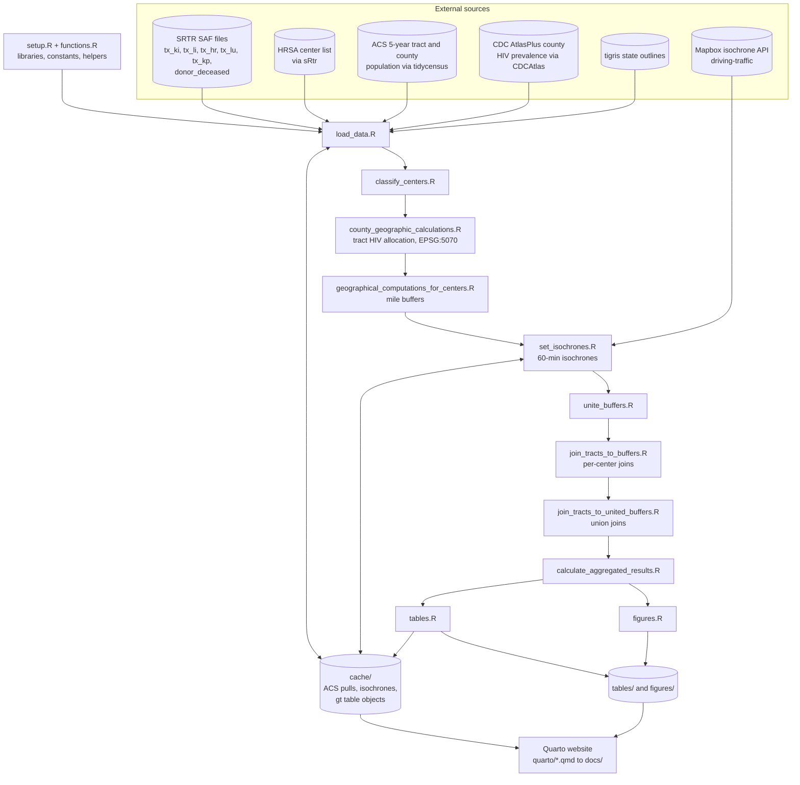
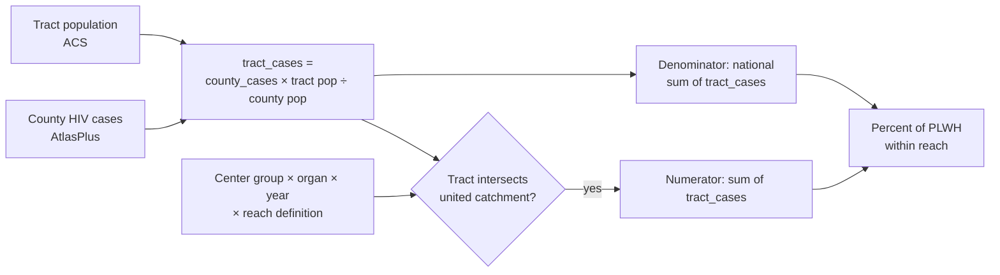

# HOPE CDC Analysis 2026 — Architecture

> Describes the code as of commit `4a5fe0a` on `master` (April 2, 2026).
> File paths are relative to the repository root.

## Overview

This project estimates what share of people living with HIV (PLWH) in the
continental United States live within reach of an adult solid-organ transplant
center, and compares that with people without HIV. It covers five organs
(kidney, liver, heart, lung, pancreas), two index years (2017, 2022), and four
reach definitions: 50, 100 and 200 mile straight-line buffers, and a 60-minute
driving isochrone. Centers are grouped three ways: all active adult centers,
centers that transplanted a recipient with HIV (HIV R+), and centers that used
an HIV-positive donor (HOPE D+).

The project has two layers:

1. **A sequential R pipeline** (`R/main.R`) that builds every object as a named
   list in the global environment and writes tables, figures and cached
   objects to disk.
2. **A Quarto website** (`_quarto.yml`, output in `docs/`) that documents each
   script and displays results by reading the pipeline's saved outputs.

## Architecture diagram

## Components

### Setup and helpers

**Location:** `R/setup.R`, `R/functions.R`

**Purpose:** Loads the analysis packages and defines the analysis grid and
shared helper functions.

**Key definitions (`R/setup.R`):**
- `organ_list`, `year_list`, `distance_list` — drive every loop in the pipeline
- `continental_fips` — states included in Census pulls
- `timezones`, `reference_date` — used to time isochrones at 7 AM local on the
  first Monday in March of each index year

**Key functions (`R/functions.R`):**
- `set_60_min_isochrone_at_7AM()` — groups centers by time zone and calls
  `mapboxapi::mb_isochrone()` with a 7 AM local departure
- `convert_resultsdf_to_table()` — builds the gt results tables
- `make_paired_plot()`, `plot_center_HIV_catchment()` — plotting helpers

### Data loading

**Location:** `R/load_data.R`

**Inputs:**
- SRTR transplant files via `load_srtr_file()`, plus deceased-donor HIV fields
  (`DON_ANTI_HIV`, `DON_HIV_NAT`)
- HRSA transplant centers via `sRtr::get_hrsa_transplant_centers()`, filtered
  by organ from `Service_Lst`, excluding Puerto Rico and Hawaii
- ACS 5-year total population (`B01003_001`) for tracts and counties
- CDC AtlasPlus county HIV prevalence via `CDCAtlas::get_atlas()`
- State outlines via `tigris::states()`

**Outputs:** `tx`, `donor_deceased`, `Transplant_centers_all`,
`us_tracts_population`, `us_counties_population`,
`AtlasPlusTableData_county_totals`, `vars`, `states_sf`

**Caching:** ACS pulls are cached to `cache/us_tracts_population_<year>.rds`
and `cache/us_counties_population_<year>.rds`. HRSA and AtlasPlus are
fetched live on every run.

### Center classification

**Location:** `R/classify_centers.R`

**Purpose:** Defines the three center groups for each organ and year.

- **Active:** at least one adult (age ≥ 216 months) transplant in the index
  calendar year.
- **HIV R+ volume:** adult recipients with HIV over the five years ending in
  the index year, restricted to active centers.
- **HOPE D+ volume:** adult recipients with HIV over the same window whose
  donor was HIV-positive by NAT or antibody.

**Outputs:** `Active_tx_centers`, `HIV_center_volumes`, `HOPE_center_volumes`,
`State_level_transplant_volumes`, `Transplant_centers_active`

### County-to-tract allocation

**Location:** `R/county_geographic_calculations.R`

**Purpose:** Projects center points to EPSG:5070 (CONUS Albers, meters), builds
the HIV and HOPE center subsets, and estimates tract-level HIV counts.

- AtlasPlus county cases are joined to ACS counties by numeric GEOID.
- Each tract receives a share of its county's cases in proportion to its
  population (`tract_cases`). `tract_noncases` is tract population minus
  `tract_cases`.
- These tract counts are estimates that assume HIV prevalence is uniform
  within a county.

**Outputs:** `Transplant_centers_all_sf`, `Transplant_centers_active_SF`,
`Transplant_centers_HIV_sf`, `Transplant_centers_HOPE_sf`, `Merged_Counties`,
`Merged_tracts`

### Reach geometry

**Location:** `R/geographical_computations_for_centers.R`,
`R/set_isochrones.R`, `R/unite_buffers.R`

- **Mile buffers:** `st_buffer()` in meters on EPSG:5070
  (50 mi = 80,467.2 m; 100 mi = 160,934.4 m; 200 mi = 321,868 m).
- **Isochrones:** 60 minutes, `driving-traffic` profile, departing 7 AM local
  time on the reference date. Each center's time zone comes from
  `lutz::tz_lookup()`. Results are cached per organ, year and center group in
  `cache/Transplant_center(s)_*_60min_buffer_*.RDS`. The all-centers
  isochrone uses the 2017 reference date.
- **Union:** each set of buffers is dissolved into a single catchment polygon
  (`catchment_area = "All Centers"`).

**Outputs:** `Transplant_center*_buffer` and `Transplant_center*_buffer_united`,
nested by organ, distance and year

### Tract joins and aggregation

**Location:** `R/join_tracts_to_buffers.R`,
`R/join_tracts_to_united_buffers.R`, `R/calculate_aggregated_results.R`

- **Per-center join:** tracts joined to each center's buffer with
  `st_intersects`. A tract inside several catchments appears once per center.
- **United join:** tracts joined to the dissolved catchment, so each tract
  counts once.
- **Aggregation:** sums `tract_cases` (active, HIV R+ and HOPE D+ groups) and
  `tract_noncases` (active group only) for tracts intersecting the united
  catchment, divided by the national tract totals.

**Outputs:** `tracts_in_buffers_*`, `tracts_in_buffers_*_united`,
`Results_HIV_df`, `Results_nonHIV_df`

### Tables and figures

**Location:** `R/tables.R`, `R/figures.R`

- **Tables:** gt objects saved as `.docx` and `.png` in `tables/<organ>/`, and
  as RDS in `cache/Results_HIV_gt.rds` and `cache/Results_nonHIV_gt.rds` for
  the website.
- **Figures:** maps, combined panels, beeswarm plots, and a DiagrammeR access
  model diagram, saved to `figures/` and `figures/<organ>/`.

### Website

**Location:** `_quarto.yml`, `index.qmd`, `quarto/*.qmd`; output in `docs/`

- A docked sidebar mirrors the pipeline: Background, Setup and helpers, Data
  loading and processing (one page per script), Tables and Figures, Results
  by organ, About.
- Script pages link to the source file on GitHub.
- Results pages read `../cache/Results_*_gt.rds` and images from
  `../figures/<organ>`.
- The `coatless-quarto/custom-callout` extension styles the source-code boxes.

## Data flow

Each result row is one combination of organ (5), year (2), center group (3)
and reach definition (4): 120 rows for PLWH and 40 rows for people without HIV
(active centers only).

## Configuration

| Setting | Where | Notes |
|---|---|---|
| Organs, years, distances | `R/setup.R` | Drive every loop |
| Continental FIPS, time zones, reference dates | `R/setup.R` | Geography and isochrone timing |
| Buffer distances in meters | `R/geographical_computations_for_centers.R` | `case_when` on the distance label |
| Mapbox token | Environment (`mapboxapi`) | Needed only when isochrones are not cached |
| Census API key | Environment (`tidycensus`) | Needed only when ACS pulls are not cached |
| SRTR file location | `sRtr` package configuration | Restricted data, not in the repository |
| Site render list, navigation, theme | `_quarto.yml` | `output-dir: docs` |

## Code references

| Component | File | Key symbols |
|---|---|---|
| Orchestration | `R/main.R` | `source()` order |
| Constants | `R/setup.R` | `organ_list`, `year_list`, `distance_list`, `reference_date` |
| Isochrones | `R/functions.R`, `R/set_isochrones.R` | `set_60_min_isochrone_at_7AM()`, `converted_times` |
| Center groups | `R/classify_centers.R` | `Active_tx_centers`, `HIV_center_volumes`, `HOPE_center_volumes` |
| Allocation | `R/county_geographic_calculations.R` | `Merged_tracts`, `tract_cases`, `tract_noncases` |
| Union | `R/unite_buffers.R` | `*_buffer_united` |
| Results | `R/calculate_aggregated_results.R` | `Results_HIV_df`, `Results_nonHIV_df` |
| Tables | `R/functions.R`, `R/tables.R` | `convert_resultsdf_to_table()`, `Results_HIV_gt` |
| Plots | `R/functions.R`, `R/figures.R` | `make_paired_plot()`, `plot_center_HIV_catchment()` |

## Glossary

| Term | Meaning in this project |
|---|---|
| Active center | Performed at least one adult transplant of that organ in the index year |
| HIV R+ center | Active center with at least one adult recipient with HIV in the five years ending in the index year |
| HOPE D+ center | Center with at least one adult HIV R+ transplant from an HIV-positive donor in that window |
| United buffer | All buffers in a center group dissolved into one polygon, so each tract counts once |
| PLWH | People living with HIV, from CDC AtlasPlus county prevalence |
| Reach definition | 50, 100 or 200 mile straight-line buffer, or 60-minute driving isochrone |

## Notes on current code state

- `R/load_tract_data_from_cache.R` is not sourced by `R/main.R`. It is a
  standalone helper for reloading cached isochrones.
- `cache/`, `tables/` and `figures/` are gitignored, so results pages render
  only on a machine that has run the pipeline. At render, Quarto copies the
  figures each page uses into `docs/figures/`, so the published site is as
  current as the last render. To update the site, run `R/main.R`, then
  render.
- Results pages find figures with `list.files()` and a filename pattern, so
  any leftover file in `figures/<organ>/` that matches the pattern also
  appears on the site.
