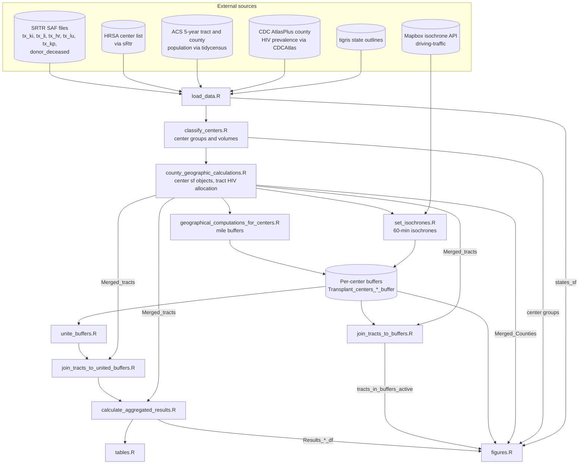
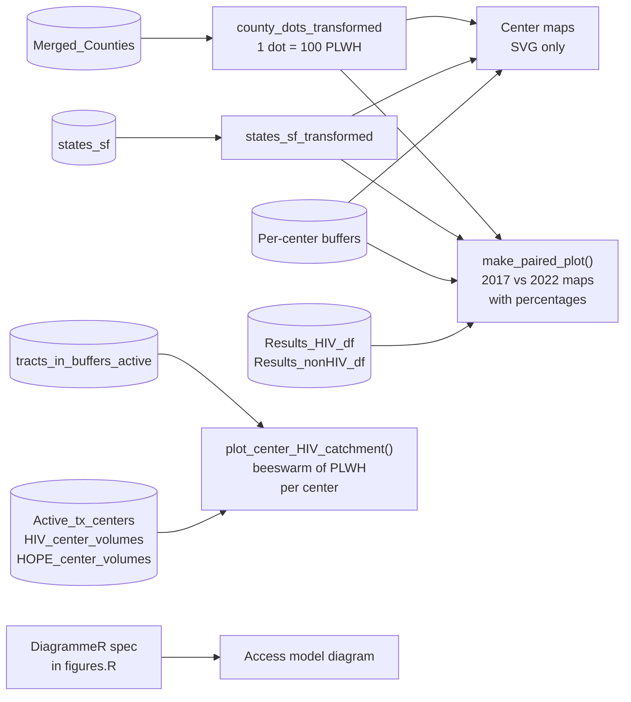
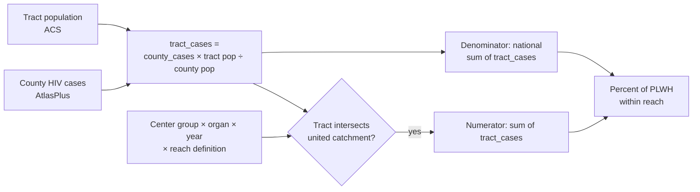

# HOPE CDC Analysis 2026 — Architecture

> Describes the code as of commit `dbf22b0` on `master` (October 23, 2026).
> File paths are relative to the repository root.

## Overview

This project estimates what share of people living with HIV (PLWH) in the
continental United States live within reach of an adult solid-organ transplant
center, and compares that with people without HIV. It covers five organs
(kidney, liver, heart, lung, pancreas), two index years (2017, 2022), and four
reach definitions: 50, 100 and 200 mile straight-line buffers, and a 60-minute
driving isochrone. Centers are grouped three ways: all active adult centers,
centers that transplanted a recipient with HIV (HIV R+), and centers that used
an HIV-positive donor (HOPE D+).

The project has two layers:

1. **A sequential R pipeline** (`R/main.R`) that builds every object as a named
   list in the global environment and writes tables, figures and cached
   objects to disk.
2. **A Quarto website** (`_quarto.yml`, output in `docs/`) that documents each
   script and displays results by reading the pipeline's saved outputs.

## Execution order

`R/main.R` sources the scripts in this order. Each script reads objects the
earlier ones left in the global environment.

1. `R/setup.R`, `R/functions.R`
2. `R/load_data.R`
3. `R/classify_centers.R`
4. `R/county_geographic_calculations.R`
5. `R/geographical_computations_for_centers.R`
6. `R/set_isochrones.R`
7. `R/unite_buffers.R`
8. `R/join_tracts_to_buffers.R`
9. `R/join_tracts_to_united_buffers.R`
10. `R/calculate_aggregated_results.R`
11. `R/tables.R`
12. `R/figures.R`

## Architecture diagram

The diagram shows data dependencies, not source order. Two branches leave the
per-center buffers: the **united branch** produces the results tables, and the
**per-center branch** feeds only the beeswarm figures.

## Components

### Setup and helpers

**Location:** `R/setup.R`, `R/functions.R`

**Purpose:** Loads the analysis packages and defines the analysis grid and
shared helper functions.

**Key definitions (`R/setup.R`):**
- `organ_list`, `year_list`, `distance_list` — drive every loop in the pipeline
- `continental_fips` — states included in Census pulls
- `timezones`, `reference_date` — used to time isochrones at 7 AM local on the
  first Monday in March of each index year

**Key functions (`R/functions.R`):**
- `set_60_min_isochrone_at_7AM()` — groups centers by time zone and calls
  `mapboxapi::mb_isochrone()` with a 7 AM local departure
- `convert_resultsdf_to_table()` — builds the gt results tables
- `make_paired_plot()`, `plot_center_HIV_catchment()` — plotting helpers,
  described under [Figures](#figures)

### Data loading

**Location:** `R/load_data.R`

**Inputs:**
- SRTR transplant files via `load_srtr_file()`, plus deceased-donor HIV fields
  (`DON_ANTI_HIV`, `DON_HIV_NAT`)
- HRSA transplant centers via `sRtr::get_hrsa_transplant_centers()`, filtered
  by organ from `Service_Lst`, excluding Puerto Rico and Hawaii
- ACS 5-year total population (`B01003_001`) for tracts and counties
- CDC AtlasPlus county HIV prevalence via `CDCAtlas::get_atlas()`
- State outlines via `tigris::states()`

**Outputs:** `tx`, `donor_deceased`, `Transplant_centers_all`,
`us_tracts_population`, `us_counties_population`,
`AtlasPlusTableData_county_totals`, `vars`, `states_sf`

**Caching:** ACS pulls are cached to `cache/us_tracts_population_<year>.rds`
and `cache/us_counties_population_<year>.rds`. HRSA and AtlasPlus are
fetched live on every run.

### Center classification

**Location:** `R/classify_centers.R`

**Purpose:** Defines the three center groups for each organ and year.

- **Active:** at least one adult (age ≥ 216 months) transplant in the index
  calendar year.
- **HIV R+ volume:** adult recipients with HIV over the five years ending in
  the index year, restricted to active centers.
- **HOPE D+ volume:** adult recipients with HIV over the same window whose
  donor was HIV-positive by NAT or antibody.

**Outputs:** `Active_tx_centers`, `HIV_center_volumes`, `HOPE_center_volumes`,
`State_level_transplant_volumes`, `Transplant_centers_active`

### County-to-tract allocation

**Location:** `R/county_geographic_calculations.R`

**Purpose:** Projects center points to EPSG:5070 (CONUS Albers, meters), builds
the HIV and HOPE center subsets, and estimates tract-level HIV counts.

- AtlasPlus county cases are joined to ACS counties by numeric GEOID.
- Each tract receives a share of its county's cases in proportion to its
  population (`tract_cases`). `tract_noncases` is tract population minus
  `tract_cases`.
- These tract counts are estimates that assume HIV prevalence is uniform
  within a county.

**Outputs:** `Transplant_centers_all_sf`, `Transplant_centers_active_SF`,
`Transplant_centers_HIV_sf`, `Transplant_centers_HOPE_sf`, `Merged_Counties`,
`Merged_tracts`

### Reach geometry

**Location:** `R/geographical_computations_for_centers.R`,
`R/set_isochrones.R`, `R/unite_buffers.R`

- **Mile buffers:** `st_buffer()` in meters on EPSG:5070
  (50 mi = 80,467.2 m; 100 mi = 160,934.4 m; 200 mi = 321,868 m).
- **Isochrones:** 60 minutes, `driving-traffic` profile, departing 7 AM local
  time on the reference date. Each center's time zone comes from
  `lutz::tz_lookup()`. Results are cached per organ, year and center group in
  `cache/Transplant_center(s)_*_60min_buffer_*.RDS`. The all-centers
  isochrone uses the 2017 reference date.
- Mile buffers and isochrones are stored in the same nested lists
  (`Transplant_centers_*_buffer[[organ]][[distance]][[year]]`), so every
  downstream step treats the four reach definitions the same way.
- **Union:** each set of buffers is dissolved into a single catchment polygon
  (`catchment_area = "All Centers"`).

**Outputs:** `Transplant_center*_buffer` (per center) and
`Transplant_center*_buffer_united` (dissolved), nested by organ, distance and
year

### Tract joins and aggregation

**Location:** `R/join_tracts_to_united_buffers.R`,
`R/calculate_aggregated_results.R`, `R/join_tracts_to_buffers.R`

These are two independent branches from the buffers, not a sequence.

- **United branch (results tables):** tracts are joined to the dissolved
  catchment with `st_intersects`, so each tract counts once. Aggregation sums
  `tract_cases` (active, HIV R+ and HOPE D+ groups) and `tract_noncases`
  (active group only) for intersecting tracts, divided by the national tract
  totals. Outputs: `tracts_in_buffers_*_united`, `Results_HIV_df`,
  `Results_nonHIV_df`.
- **Per-center branch (beeswarm figures):** tracts are joined to each
  center's own buffer. A tract inside several catchments appears once per
  center, which is intended here because the figure shows each center's own
  catchment. Outputs: `tracts_in_buffers_active`, `tracts_in_buffers_HIV`,
  `tracts_in_buffers_HOPE`. Only `tracts_in_buffers_active` is used
  downstream.

### Tables

**Location:** `R/tables.R`

gt objects built by `convert_resultsdf_to_table()` from `Results_HIV_df` and
`Results_nonHIV_df`. Saved as `.docx` and `.png` in `tables/<organ>/`, and as
RDS in `cache/Results_HIV_gt.rds` and `cache/Results_nonHIV_gt.rds` for the
website.

### Figures

**Location:** `R/figures.R`, with helpers in `R/functions.R`

`R/figures.R` builds five families of figures. Two shared layers are built
first and reused by the helpers: `county_dots_transformed`, a dot-density
layer of county HIV cases from `tidycensus::as_dot_density()` at 100 cases
per dot, and `states_sf_transformed`, the state outlines. Both are projected
to EPSG:5070.

| Family | Built by | Inputs | Output files | Used on site |
|---|---|---|---|---|
| Access model diagram | `grViz()` in `figures.R` | None (hand-written spec) | `figures/hope_cdc_access_model.svg`, `.png` | `quarto/analysis_methods.qmd` |
| Center maps | `figures.R` loop | Dots, states, active and HIV R+ buffers | `figures/<organ>/Active <organ> <distance> map<year>.svg`, `HIV <organ> ...svg` | No |
| Paired plots, PLWH and people without HIV | `make_paired_plot(include_nonHIV = TRUE)` | Dots, states, active buffers, both results tables | `figures/<organ>/Active<organ>CenterCombinedPlot<distance>.png` | Results page, first section |
| Paired plots, PLWH by center group | `make_paired_plot()` | Dots, states, active, HIV R+ or HOPE D+ buffers, `Results_HIV_df` | `figures/<organ>/Combined <organ> plot 2026-2-14 <distance> <active/HIV/HOPE>.png` | Results page, second section |
| Beeswarm plots | `plot_center_HIV_catchment()` | `tracts_in_buffers_active`, center groups | `figures/<organ>/Beeswarm <organ> plot 2026-2-14 <distance>.png` | Results page, third section |

Every family except the diagram is also saved as `.svg`.

**Paired plots** (`make_paired_plot()`): two maps side by side, one per index
year. Each shows the dot-density layer, the per-center catchment outlines in
red, and state outlines. The headline percentage and the numerator and
denominator above each map come from the results tables, so the numbers come
from the united branch while the outlines are drawn from the per-center
buffers.

**Beeswarm plots** (`plot_center_HIV_catchment()`): sums `tract_cases` within
each active center's own catchment, giving the estimated PLWH near each
center. Centers are grouped by status in each year (HOPE center, at least one
HIV R+ transplant, no HIV R+ transplants) and faceted by year. Point color
shows each center's status in the first year, so movement between groups is
visible. The plot adds a violin, a median bar, and a Kruskal–Wallis test
across groups (`ggpubr::stat_compare_means()`).

**Implicit inputs:** both helpers read global objects that are not passed as
arguments. `make_paired_plot()` reads `Results_HIV_df`, `Results_nonHIV_df`,
`county_dots_transformed`, `states_sf_transformed` and `year_list`.
`plot_center_HIV_catchment()` reads `Active_tx_centers`,
`HIV_center_volumes`, `HOPE_center_volumes` and `year_list`. They work only
after `R/figures.R` has built the shared layers and the earlier scripts have
run.

### Website

**Location:** `_quarto.yml`, `index.qmd`, `quarto/*.qmd`; output in `docs/`

- A docked sidebar mirrors the pipeline: Background, Setup and helpers, Data
  loading and processing (one page per script), Tables and Figures, Results
  by organ, About.
- **Script pages pull code from the scripts at render time.** Pages for
  scripts with labeled sections (`## ---- label`) call `knitr::read_chunk()`
  and show each section next to its explanation: setup, functions,
  load_data, county_geographic_calculations, calculate_aggregated_results
  and figures. The remaining script pages show the whole script with the
  `file:` chunk option. Code on these pages is displayed, not run.
- Results pages read `../cache/Results_*_gt.rds` and find figures in
  `../figures/<organ>` with `list.files()` and a filename pattern.
- The `coatless-quarto/custom-callout` extension styles the source-code boxes.
- `repo-branch: master` points the edit and issue links at the right branch.

## Data flow for the results tables

Each result row is one combination of organ (5), year (2), center group (3)
and reach definition (4): 120 rows for PLWH and 40 rows for people without HIV
(active centers only).

## Configuration

| Setting | Where | Notes |
|---|---|---|
| Organs, years, distances | `R/setup.R` | Drive every loop |
| Continental FIPS, time zones, reference dates | `R/setup.R` | Geography and isochrone timing |
| Buffer distances in meters | `R/geographical_computations_for_centers.R` | `case_when` on the distance label |
| Dots per case | `R/figures.R` | `values_per_dot = 100` |
| Mapbox token | Environment (`mapboxapi`) | Needed only when isochrones are not cached |
| Census API key | Environment (`tidycensus`) | Needed only when ACS pulls are not cached |
| SRTR file location | `sRtr` package configuration | Restricted data, not in the repository |
| Site render list, navigation, theme, branch | `_quarto.yml` | `output-dir: docs`, `repo-branch: master` |

## Code references

| Component | File | Key symbols |
|---|---|---|
| Orchestration | `R/main.R` | `source()` order |
| Constants | `R/setup.R` | `organ_list`, `year_list`, `distance_list`, `reference_date` |
| Isochrones | `R/functions.R`, `R/set_isochrones.R` | `set_60_min_isochrone_at_7AM()`, `converted_times` |
| Center groups | `R/classify_centers.R` | `Active_tx_centers`, `HIV_center_volumes`, `HOPE_center_volumes` |
| Allocation | `R/county_geographic_calculations.R` | `Merged_Counties`, `Merged_tracts`, `tract_cases`, `tract_noncases` |
| Union | `R/unite_buffers.R` | `*_buffer_united` |
| Results | `R/calculate_aggregated_results.R` | `Results_HIV_df`, `Results_nonHIV_df` |
| Tables | `R/functions.R`, `R/tables.R` | `convert_resultsdf_to_table()`, `Results_HIV_gt` |
| Figure layers | `R/figures.R` | `county_dots_transformed`, `states_sf_transformed` |
| Paired plots | `R/functions.R`, `R/figures.R` | `make_paired_plot()` |
| Beeswarm plots | `R/functions.R`, `R/figures.R` | `plot_center_HIV_catchment()` |

## Glossary

| Term | Meaning in this project |
|---|---|
| Active center | Performed at least one adult transplant of that organ in the index year |
| HIV R+ center | Active center with at least one adult recipient with HIV in the five years ending in the index year |
| HOPE D+ center | Center with at least one adult HIV R+ transplant from an HIV-positive donor in that window |
| Per-center buffer | One catchment polygon per center; catchments can overlap |
| United buffer | All buffers in a center group dissolved into one polygon, so each tract counts once |
| PLWH | People living with HIV, from CDC AtlasPlus county prevalence |
| Reach definition | 50, 100 or 200 mile straight-line buffer, or 60-minute driving isochrone |

## Notes on current code state

- **Computed but not used downstream:** `tracts_in_buffers_HIV`,
  `tracts_in_buffers_HOPE`, `Transplant_center_all_buffer` and its united
  version, `State_level_transplant_volumes`, and `vars`. The all-centers
  buffers include 60-minute isochrones, so on a cache miss the pipeline makes
  Mapbox calls whose results nothing reads.
- The center maps are saved as SVG only and are not shown on the site.
- `R/load_tract_data_from_cache.R` is not sourced by `R/main.R`. It is a
  standalone helper for reloading cached isochrones.
- `cache/`, `tables/` and `figures/` are gitignored, so results pages render
  only on a machine that has run the pipeline. At render, Quarto copies the
  figures each page uses into `docs/figures/`, so the published site is as
  current as the last render. To update the site, run `R/main.R`, then
  render.
- Results pages find figures with `list.files()` and a filename pattern, so
  any leftover file in `figures/<organ>/` that matches the pattern also
  appears on the site.
