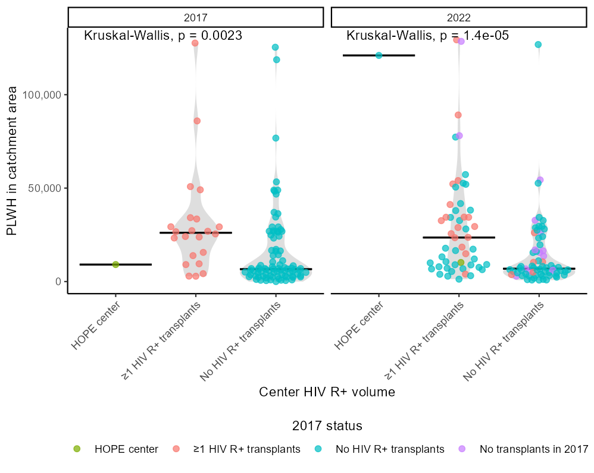
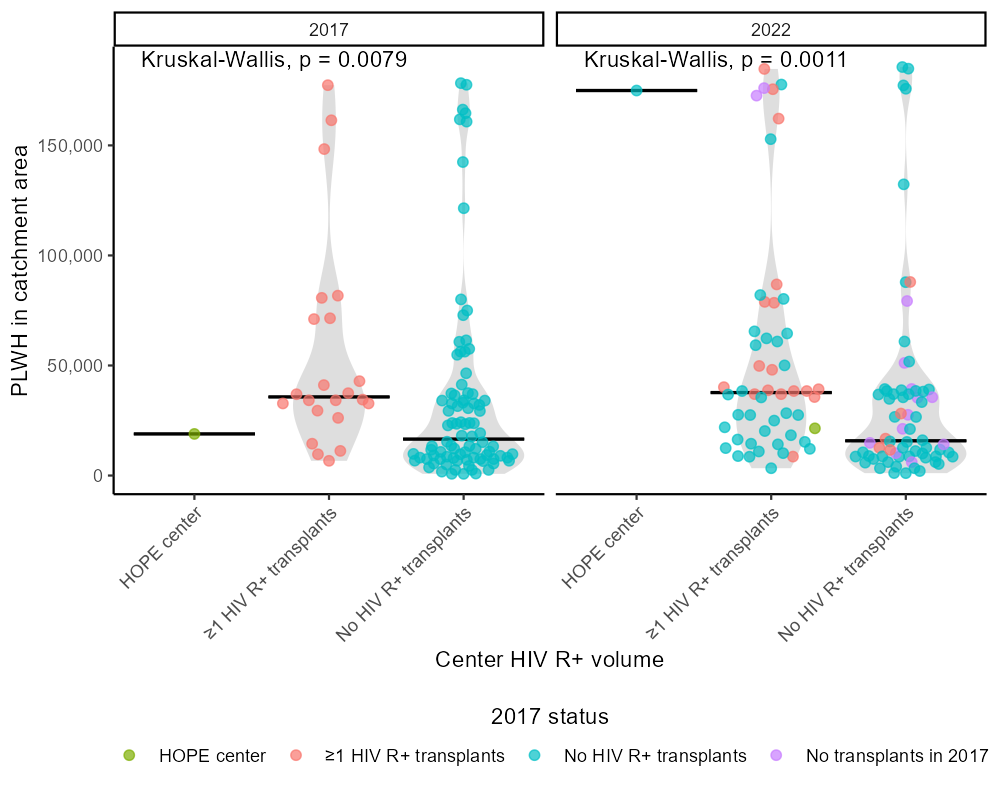
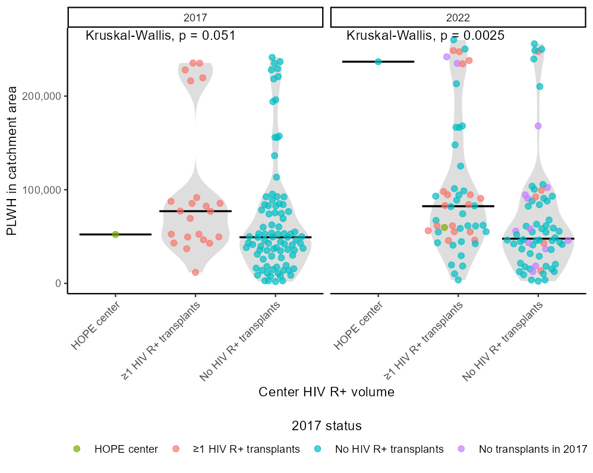

## Table 1 and Table 2: Summary results in PLWH and without HIV


```{r}
#| eval: true
#| include: false

# Results come from the cleared outputs in site-outputs/, written by
# R/tables.R and R/figures.R. This page runs no analysis code.

organ <- "heart"

# HOPE D+ rows and figures are hidden for organs with no HOPE D+ centers,
# where the aggregation currently reports 100% (empty-group defect, to be
# fixed in the refactor).
hide_hope <- FALSE

out_dir <- file.path("..", "site-outputs")

show_table <- function(file) {
  x <- paste(readLines(file.path(out_dir, "tables", file), warn = FALSE, encoding = "UTF-8"),
             collapse = "\n")
  if (hide_hope) {
    x <- gsub("(?s)<tr\\b(?:(?!</tr>).)*?HOPE(?:(?!</tr>).)*?</tr>", "", x, perl = TRUE)
  }
  cat(x)
}

site_figures <- function(pattern, keep = NULL, drop = NULL) {
  f <- list.files(file.path(out_dir, "figures", organ), pattern = pattern, full.names = TRUE)
  if (!is.null(keep)) f <- f[grepl(keep, basename(f), fixed = TRUE)]
  if (!is.null(drop)) f <- f[!grepl(drop, basename(f), fixed = TRUE)]
  if (hide_hope) f <- f[!grepl("HOPE", basename(f), fixed = TRUE)]
  distance <- as.numeric(regmatches(f, regexpr("[0-9]+(?=(mile|min))", f, perl = TRUE)))
  f[order(distance, tolower(basename(f)))]
}
```


### Table 1: People Living With HIV (PLWH)

This table summarizes the number and proportion of people living with HIV who reside within defined catchment areas of:

- Active transplant centers  
- HIV R+ transplant centers  
- HOPE Act D+ centers  

Catchment areas are defined by:

- 50-mile radius  
- 60-minute driving time  
- 100-mile radius  
- 200-mile radius  

Results are shown for 2017 and 2022.

---

```{r}
#| eval: true
#| echo: false
#| output: asis
show_table(paste0(organ, "_hiv.html"))
```

### Table 2: Individuals Without HIV

This table presents the same catchment analysis for individuals without HIV.  

It allows direct comparison of geographic access between:

- PLWH  
- Individuals without HIV  

---

```{r}
#| eval: true
#| echo: false
#| output: asis
show_table(paste0(organ, "_nonhiv.html"))
```


## Figures

Figures are grouped into three sections.

---

### Compare PLWH and non-HIV

These figures compare geographic access between PLWH and individuals without HIV within each catchment definition.

Each panel corresponds to a distance-based definition:

- 50 miles  
- 60 minutes  
- 100 miles  
- 200 miles  

These figures highlight disparities in access by HIV status.

---

```{r}
#| eval: true
#| echo: false
knitr::include_graphics(site_figures("CombinedPlot.*\\.png$", keep = "Active"))
```

---

### Compare PLWH Between Years

These figures evaluate changes in geographic access among PLWH between 2017 and 2022.

For each catchment definition, results are shown for:

- Active centers  
- HIV R+ centers  
- HOPE Act D+ centers  

This section highlights temporal changes in transplant center availability.

---


```{r}
#| eval: true
#| echo: false
knitr::include_graphics(site_figures("^Combined.*\\.png$"))
```

---

### Beeswarm Plots

In these beeswarm plots, we plot the number of PLWh in each transplant center's catchment area, classifying centers by whether or not they had performed an HIV R+ heart transplant in 2013-2017 and 2018-2022, respectively.

Each point represents a transplant center, with the distribution shown for each distance definition.

These plots illustrate variability in geographic access across centers rather than only aggregate proportions.


The 50-mile results are below.


The 60-minute results are below.


The 100-mile results are below.


The 200-mile results are below.

